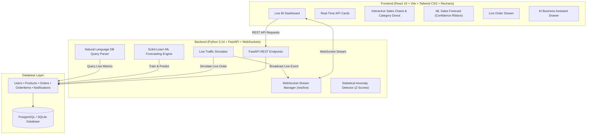

# SmartPulse – AI-Powered Real-Time Business Intelligence Dashboard

> **Enterprise Full-Stack BI Platform** combining **React.js**, **FastAPI**, **PostgreSQL / SQLite**, **WebSockets**, and **Scikit-learn Machine Learning** for real-time sales analytics, AI forecasting, and automated business decision-making.

---

## 🌟 Executive Overview
**SmartPulse** transforms raw business transaction streams into actionable, real-time intelligence. Instead of static reports or periodic batch spreadsheets, SmartPulse provides business leaders with instant visibility into sales, profit margins, product velocity, inventory risks, and predictive demand forecasting.

---

## 🏛️ System Architecture



---

## 🚀 Key Features

### 1. 📊 Real-Time Analytics Dashboard
- **KPI Metrics**: Total Revenue, Completed Orders, Active Customers, Gross Profit, Net Margin %, and Average Order Value (AOV).
- **Dynamic Date Filtering**: Switch between **Today**, **Last 7 Days**, **Last 30 Days**, and **Last 90 Days** with instant database re-aggregation.
- **Interactive Visualizations**:
  - Composed Daily Revenue (Area/Bar) vs Profit Trend Line.
  - Category Share Donut Chart with revenue breakdowns.
  - Top-Grossing Products leaderboard with stock health indicators.

### 2. ⚡ Live WebSocket Real-Time Integration
- Continuous bidirectional WebSocket connection at `/ws/live`.
- **Instant Event Propagation**: When an order is completed, the backend automatically:
  1. Inserts the order & items into the database.
  2. Decrements product inventory in real time.
  3. Checks for low-stock thresholds or statistical anomalies.
  4. Broadcasts a `NEW_ORDER` payload over WebSockets.
  5. The frontend flashes an incoming order banner, updates KPI counters without full reload, and appends to the live activity feed!
- **Interactive Demo Simulator**: Includes a **"⚡ Simulate Order"** button in the top navigation bar to trigger live transactions on demand during interview demonstrations.

### 3. 🔮 Machine Learning Sales Forecasting (Scikit-Learn)
- **Time-Series Regression**: Fits Ridge/Linear regression with polynomial trend features and day-of-week seasonality factors.
- **Prediction Horizon**: Selectable 7-day, 14-day, and 30-day forward projections.
- **Confidence Intervals**: Computes 95% upper and lower statistical confidence ribbons based on residual standard deviation.
- **Model Evaluation**: Displays real-time **R² Score** (accuracy) and **Mean Absolute Error (MAE)**.
- **Prescriptive Recommendations**: Auto-generates inventory and promotional advice based on growth trajectory.

### 4. 🚨 Anomaly Detection & Inventory Safety
- **Z-Score Anomaly Engine**: Detects statistical revenue drops ($> 1.8\sigma$ below 30-day baseline) or unexpected demand surges.
- **Stock Depletion Warnings**: Automatically flags products falling below minimum safety stock levels (`min_stock_threshold`) with one-click restocking action.

### 5. 🤖 AI Business Assistant (Natural Language Database Query Engine)
- Integrated chatbot capable of answering direct questions about business performance from live data:
  - *"What is today's revenue?"*
  - *"Which product generated the highest revenue?"*
  - *"How many orders were received this month?"*
  - *"Which products are low in stock?"*
  - *"Predict next month's sales"*
  - *"Why did sales decrease?"*
- Never hallucinates figures; executes verified SQL aggregations against live records.

### 6. 📄 Reports & CSV / PDF Export
- Complete audit ledger of all orders.
- Direct **Export CSV** download compliant with RFC 4180.
- Print / PDF summary statement.

---

## 🛠️ Technology Stack

| Layer | Technologies |
|---|---|
| **Frontend** | React 19, Vite, Tailwind CSS v4, Recharts, Lucide React, Axios |
| **Backend** | Python 3.14 / 3.11, FastAPI, Uvicorn, SQLAlchemy, Pydantic v2 |
| **Real-Time** | WebSockets (Native ASGI bidirectional stream) |
| **AI / ML** | Scikit-learn (Ridge Regression, Residuals), Pandas, NumPy |
| **Database** | SQLite (Zero-config out of the box) / PostgreSQL support |
| **DevOps** | Batch launch scripts (`start_all.bat`), CORS middleware |

---

## ⚡ Quick Start & Run

### Option 1: One-Click Startup (Windows)
Double-click:
```cmd
start_all.bat
```
This automatically launches:
1. Backend on `http://127.0.0.1:8000` (auto-seeds 1,100+ historical orders if empty).
2. Frontend on `http://localhost:5173`.

---

### Option 2: Manual Terminal Commands

#### 1. Backend:
```bash
cd backend
# Activate virtual environment
venv\Scripts\activate
# Start FastAPI
python run.py
```
> Swagger API Documentation: `http://127.0.0.1:8000/docs`

#### 2. Frontend:
```bash
cd frontend
npm run dev
```
> Open browser at: `http://localhost:5173`

---

## 🎯 How to Explain This Project in an Interview

### 30-Second Elevator Pitch
> *"My project is **SmartPulse**, an AI-powered real-time Business Intelligence dashboard built with React, FastAPI, WebSockets, and Scikit-learn. 
> Unlike traditional static BI dashboards that rely on scheduled batch jobs, SmartPulse streams live transaction events over WebSockets, instantly recomputing KPIs, margins, and inventory health. 
> I also built an ML time-series forecasting engine with Scikit-learn to project future sales with 95% confidence bounds, and a natural language AI Business Assistant that queries the live database to answer business questions directly."*

### Key Technical Talking Points for the Interviewer
1. **Real-Time Architecture**:
   - *"How did you handle real-time synchronization?"*
   - **Answer**: *"I implemented an ASGI WebSocket connection manager in FastAPI. When an order event is processed via the `/api/orders` endpoint, it decrements product stock, checks against safety thresholds, saves in the database, and immediately broadcasts a payload to all connected clients. The React frontend updates state reactively without requiring expensive polling."*

2. **Machine Learning Model**:
   - *"How does your sales forecasting work?"*
   - **Answer**: *"I aggregate historical daily sales using SQLAlchemy and Pandas, engineer features for day-of-week seasonality and linear trend, and fit a Ridge regression model with Scikit-learn. The model projects the next 14 to 30 days and calculates residual standard deviation to render an upper and lower 95% confidence ribbon."*

3. **Database Performance**:
   - *"How do you handle analytics queries without slowing down transaction processing?"*
   - **Answer**: *"We use indexed foreign keys and timestamps on Order and Product tables, aggregate queries using SQL `func.sum` and `func.count`, and compute rolling metrics on filtered date windows."*

---

## 📂 Project Directory Structure

```
AIML PROJECT/
├── backend/
│   ├── app/
│   │   ├── config.py             # App configurations & settings
│   │   ├── database.py           # SQLAlchemy engine & session maker
│   │   ├── models.py             # User, Product, Customer, Order, Notification
│   │   ├── schemas.py            # Pydantic request & response models
│   │   ├── seed_data.py          # Realistic 90-day business dataset seeder
│   │   ├── simulator.py          # Live order generator & WebSocket broadcaster
│   │   ├── ml/
│   │   │   ├── forecast.py       # Scikit-learn sales prediction & metrics
│   │   │   └── anomaly.py        # Statistical Z-score & inventory anomaly engine
│   │   ├── routers/
│   │   │   ├── analytics.py      # KPIs, sales trends, category performance
│   │   │   ├── predictions.py    # AI forecast & anomaly endpoints
│   │   │   ├── assistant.py      # AI Natural Language business assistant
│   │   │   ├── orders.py         # Order transactions & WebSocket trigger
│   │   │   ├── products.py       # Product catalog & inventory restocking
│   │   │   ├── reports.py        # Executive statements & CSV export
│   │   │   ├── notifications.py  # Notification logs & read status
│   │   │   └── websocket.py      # WebSocket connection manager
│   │   └── main.py               # FastAPI application entry point
│   ├── requirements.txt          # Python dependencies
│   ├── run.py                    # Server runner
│   └── test_server.py            # Comprehensive verification test suite
├── frontend/
│   ├── src/
│   │   ├── components/
│   │   │   ├── Navbar.jsx        # Top bar with live WS indicator & simulate button
│   │   │   ├── Sidebar.jsx       # Multi-tab navigation
│   │   │   ├── KPICards.jsx      # Metric stat cards with percentage changes
│   │   │   ├── SalesRevenueChart.jsx  # Recharts Composed Area/Line chart
│   │   │   ├── CategoryPieChart.jsx   # Segment distribution donut chart
│   │   │   ├── TopProductsTable.jsx   # Leaderboard with stock status
│   │   │   ├── RecentOrdersFeed.jsx   # Real-time transaction stream
│   │   │   ├── ForecastChart.jsx      # ML Forecast with confidence interval
│   │   │   ├── InventoryView.jsx      # Stock management & +25 unit restock action
│   │   │   ├── OrdersView.jsx         # Full order book & manual order creator
│   │   │   ├── ReportsView.jsx        # Statement & CSV export
│   │   │   ├── AlertsBanner.jsx       # Real-time WebSocket toasts & anomaly alerts
│   │   │   ├── AIAssistantModal.jsx   # Interactive business chatbot
│   │   │   └── NotificationsDrawer.jsx# Notification history drawer
│   │   ├── context/
│   │   │   └── DashboardContext.jsx  # Central reactive state & WS listener
│   │   ├── services/
│   │   │   └── api.js                # Axios client & WebSocket connector
│   │   ├── App.jsx                   # Main layout and tab router
│   │   ├── main.jsx                  # React DOM mount
│   │   └── index.css                 # Tailwind CSS styling & animations
│   ├── package.json
│   └── vite.config.js
├── start_all.bat                 # One-click dual launcher
├── start_backend.bat             # Backend launcher
├── start_frontend.bat            # Frontend launcher
└── README.md                     # Documentation & Interview guide
```

